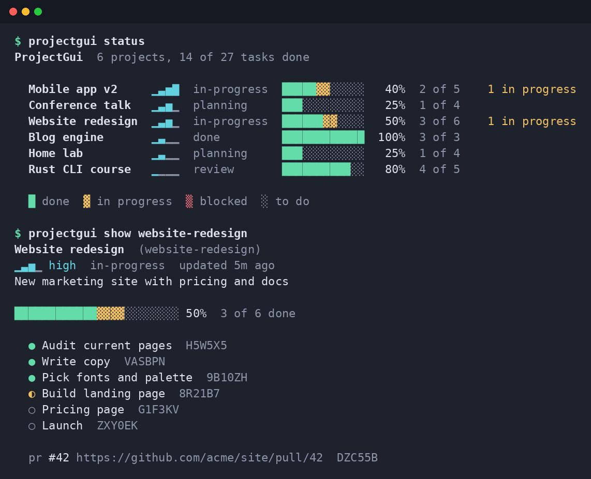
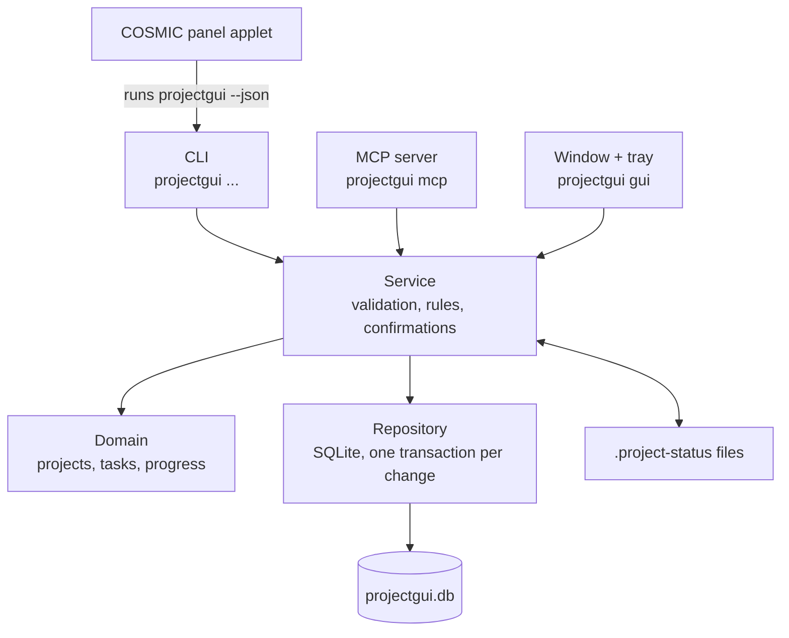

<p align="center"></p>

# ProjectGui

**A local project tracker for people who juggle many projects, and for the coding agents that help them.**

ProjectGui keeps a list of your projects, each with a priority, a stage and a list of tasks. Progress is never
typed in by hand: it is calculated from the tasks you finish. You can use the same data from several places:

- a **command line** (`projectgui status`) with colored progress bars,
- an **MCP server**, so Claude Code, Codex, OpenCode and other agents can read and update your projects,
- a **desktop window** with a **tray icon** on Linux,
- a **COSMIC panel applet** that shows your progress in the top bar.

Everything lives in one SQLite file on your machine. No account, no cloud, no background service.



---

## Contents

1. [Features](#features)
2. [Install](#install)
3. [Five-minute tutorial](#five-minute-tutorial)
4. [Keep a status file in your repository](#keep-a-status-file-in-your-repository)
5. [Let your coding agent manage tasks (MCP)](#let-your-coding-agent-manage-tasks-mcp)
6. [The desktop window, tray and panel applet](#the-desktop-window-tray-and-panel-applet)
7. [Your data: location, backup, export](#your-data-location-backup-export)
8. [Updates](#updates)
9. [Configuration reference](#configuration-reference)
10. [Platform support](#platform-support)
11. [How it works](#how-it-works)
12. [Development](#development)

---

## Features

- **Projects** with title, description, priority (`low`, `medium`, `high`, `critical`) and stage (`idea`,
  `planning`, `in-progress`, `review`, `done`, `paused`). Archive what you are not working on.
- **Tasks** with status `todo`, `in-progress`, `blocked` or `done`. The progress bar shows each state in its own color.
- **References**: attach commit hashes, pull requests and issues to a project or task (stored locally, nothing is synced).
- **Fuzzy lookups for reading, exact names for writing.** `projectgui show web` finds "Website redesign", but a
  command that changes data needs the exact slug or id, so a typo never edits the wrong project.
- **`.project-status` file**: a small TOML file in a project folder, kept in step with the database both ways.
- **MCP server** with tools, resources and prompts; one command registers it with Claude Code, Codex and OpenCode.
- **Safe for concurrent use**: the CLI, the agents and the window can all write at the same time.
- **COSMIC panel applet**: overall progress in the top bar, tick tasks off without opening the window.
- **Scriptable**: every data command has `--json`; exit codes are stable and documented in `--help`.

---

## Install

### Installer (recommended)

Linux and macOS:

```sh
curl --proto '=https' --tlsv1.2 -LsSf https://github.com/Gu1L3RM3/projectgui/releases/latest/download/projectgui-installer.sh | sh
```

Windows (PowerShell):

```powershell
powershell -ExecutionPolicy Bypass -c "irm https://github.com/Gu1L3RM3/projectgui/releases/latest/download/projectgui-installer.ps1 | iex"
```

The installer puts `projectgui` in `~/.cargo/bin` (it tells you if that folder is not on your `PATH`). Installed this
way, `projectgui update` can update itself later.

### Download an archive

Every [release](https://github.com/Gu1L3RM3/projectgui/releases) has archives for Linux (x86_64, arm64),
macOS (Intel, Apple Silicon) and Windows (x86_64), with SHA-256 checksums. Unpack and put the binary on your `PATH`.

### Build from source

You need a recent stable [Rust toolchain](https://rustup.rs) and a C compiler (SQLite is compiled in).

```sh
git clone https://github.com/Gu1L3RM3/projectgui
cd projectgui
cargo install --path .                 # CLI + MCP server + update check
cargo install --path . --features gui  # also the desktop window and tray
```

Check that it works:

```sh
projectgui version
```

---

## Five-minute tutorial

### 1. Create a project with a few tasks

```sh
projectgui add "Website redesign" -p high -s in-progress \
  -d "New marketing site" \
  -t "Write copy" -t "Pick fonts" -t "Build landing page"
```

Each project gets a **slug** (`website-redesign`) that you use to refer to it. If you rename the project later, the
old slug keeps working.

### 2. See everything at a glance

```sh
projectgui status
```

One line per project: priority signal, stage, a progress bar and how many tasks are done. Projects are sorted by
priority; try `projectgui list --sort progress` or `projectgui list --help` for filters.

### 3. Look inside a project

```sh
projectgui show website-redesign
```

```
Website redesign  (website-redesign)
▁▃▅▁ high  in-progress  updated just now
New marketing site

░░░░░░░░░░░░░░░░░░░░░░░░ 0%  0 of 3 done

  ○ Write copy  2F7F2A
  ○ Pick fonts  Q46F5K
  ○ Build landing page  4TC1DN
```

The short code after each task is the end of its id. Use it to point at a task.

### 4. Move tasks forward

```sh
projectgui task start website-redesign 2F7F2A      # in progress
projectgui task done  website-redesign 2F7F2A      # done: the progress bar moves
projectgui task block website-redesign Q46F5K      # blocked
projectgui task add   website-redesign "Pricing page" "Launch"
```

### 5. Change the project itself

```sh
projectgui edit website-redesign --stage review --priority critical
projectgui archive website-redesign                 # hide it; `unarchive` brings it back
```

### 6. Link a folder to a project

Inside the project's folder:

```sh
cd ~/code/website
projectgui link website-redesign
projectgui status --here                            # shows the project for the current folder
```

### Tips

- `projectgui --help` and `projectgui <command> --help` explain every option, the exit codes and environment variables.
- Add `--json` to any data command to use it in scripts: `projectgui list --json | jq '.[].title'`.
- Deleting is deliberate: `projectgui rm website-redesign` asks you to type the project's title.

---

## Keep a status file in your repository

A `.project-status` file is a TOML description of the project that lives next to your code. It is handy for
reviewing project status in pull requests, or for editing tasks in your editor.

```sh
cd ~/code/website
projectgui init-file            # writes .project-status for the linked project
```

```toml
title = "Website redesign"
description = "New marketing site"
priority = "high"
stage = "in-progress"

[[task]]
title = "Write copy"
status = "done"

[[task]]
title = "Pick fonts"
status = "in-progress"
```

How it stays in sync:

- **You edit the file**, then run `projectgui sync` to load it into the database.
- **You change the project anywhere else** (CLI, window, agent): ProjectGui writes the change back into the file.
- If you edited the file and have not synced yet, ProjectGui does **not** overwrite it; it tells you instead.
- Tasks missing from the file are never deleted from the database.

Find and load many files at once: `projectgui scan ~/code` (dry run) and `projectgui scan ~/code --apply`.

Full format: [docs/project-file.md](docs/project-file.md).

---

## Let your coding agent manage tasks (MCP)

ProjectGui includes an [MCP](https://modelcontextprotocol.io) server. Once registered, your agent can list projects,
create tasks, mark them done and attach pull requests while it works.

```sh
projectgui install-mcp all            # dry run: shows what it would change
projectgui install-mcp all --write    # registers with Claude Code, Codex and OpenCode
```

Then ask your agent things like:

> "Which of my projects has the most blocked tasks?"
>
> "Create a project for this repository with tasks for the TODOs in the README."
>
> "Mark the 'Write copy' task in website-redesign as done and attach PR #42."

Safety rules the server enforces (not just the agent):

- Changing data requires the full project or task id; the agent cannot act on a guessed name.
- Deleting a project requires the exact title; removing a task requires an explicit confirmation.
- The server never uses the network.

Tools, resources, prompts and manual setup for other clients: [docs/agents.md](docs/agents.md).

---

## The desktop window, tray and panel applet

Start it with:

```sh
projectgui gui
```

(Requires a build with the `gui` feature; the installers and release archives include it.)

What you can do in the window:

- See every project as a row with a segmented progress bar; click a row to open its tasks.
- Change task status, add, rename and remove tasks.
- Create, edit, archive and delete projects; add references.
- Search (title, slug, description, task titles), sort, and filter by priority or stage.
- Changes from the CLI or an agent appear within about two seconds.

**Themes.** Pick one in the footer: *frosted* (translucent, default), *slate*, *paper*, *dusk* and *contrast*.
The choice is saved in the config file. Set the frosted window's opacity with
`projectgui config set gui_opacity 70` (20-100).

**Tray (Linux).** While the window is open, a tray icon shows your top open projects with their progress, an update
notice when there is one, *Open* and *Quit*. Running `projectgui gui` again brings the open window to the front
instead of starting a second copy. When the COSMIC panel applet (below) is running, the window skips the tray icon, since the
applet already shows the same projects.

### COSMIC panel applet

On the COSMIC desktop you can also keep ProjectGui in the top panel: the icon shows overall progress, and a click opens
a popup with your open projects. Click a project to see its tasks and tick them off; *Open ProjectGui* opens the window.

The applet is built from source (it needs [libcosmic](https://github.com/pop-os/libcosmic)) and talks to the
`projectgui` command you installed above:

```sh
cd applet
cargo build --release
./install.sh        # applet, icons and a ProjectGui launcher under ~/.local
```

Then add it in *Settings → Desktop → Panel → Configure panel applets → Add applet → ProjectGui*.

---

## Your data: location, backup, export

```sh
projectgui config path          # where the config file and the database are
```

| Task | Command |
|---|---|
| Consistent copy of the database (safe while other programs write) | `projectgui backup` or `projectgui backup --out ~/pg-backup.db` |
| Everything as JSON | `projectgui export --out projects.json` |
| Merge a JSON export (existing ids are kept) | `projectgui import projects.json` |
| Use another database (e.g. a synced folder) | `PROJECTGUI_DB=/path/to/file.db projectgui status` |

Ids are [ULIDs](https://github.com/ulid/spec) and never change, so exports from two machines merge cleanly.

---

## Updates

```sh
projectgui update --check       # only report (exit code 10 means an update is available)
projectgui update               # update in place (when installed with the installer)
```

Once a day, interactive commands check GitHub for a newer release in the background and print a one-line notice.
The check is skipped in `--json` mode, when output is not a terminal, and in the MCP server. Turn it off with
`projectgui config set update.check false` or `PROJECTGUI_NO_UPDATE_CHECK=1`.

Details, including the `notice.json` format: [docs/update.md](docs/update.md).

---

## Configuration reference

`projectgui config list` prints all settings; `projectgui config set <key> <value>` changes one.

| Setting | Default | Meaning |
|---|---|---|
| `db_path` | platform data dir | database file |
| `color` | `auto` | `auto`, `always`, `never` |
| `ascii` | `false` | plain ASCII progress bars |
| `default_sort` | `priority` | sort order of `status` and `list` |
| `gui_theme` | `frosted` | window theme |
| `gui_opacity` | `80` | frosted window opacity (20-100) |
| `update.check` | `true` | daily background update check |

| Environment variable | Effect |
|---|---|
| `PROJECTGUI_DB` | database file path |
| `PROJECTGUI_CONFIG` | config file path |
| `NO_COLOR` | disable colors |
| `COLORTERM=truecolor` | the terminal uses the window's exact colors |
| `PROJECTGUI_NO_UPDATE_CHECK` | disable the background update check |

---

## Platform support

| | Linux | macOS | Windows |
|---|---|---|---|
| CLI and MCP server | tested by hand and in CI | tested in CI | tested in CI |
| Desktop window | tested by hand (COSMIC) | builds; not tested by hand | builds; not tested by hand |
| Tray icon | yes (StatusNotifierItem) | no | no |
| Panel applet | COSMIC | no | no |

Reports from macOS and Windows users are welcome.

---

## How it works



- The three front ends are thin: they parse input, call the service and show the result.
- All rules (validation, exact names for changes, confirmation before deleting) live in the service, so the CLI,
  the agents and the window behave the same way.
- Every change is one SQLite transaction, so separate processes can write at the same time without losing updates.

---

## Development

```sh
cargo build
cargo test
cargo fmt --check
cargo clippy --all-targets --all-features -- -D warnings
```

Try the CLI against a throwaway database, never your real one:

```sh
export PROJECTGUI_DB=/tmp/pg.db PROJECTGUI_CONFIG=/tmp/pg.toml
cargo run -- add "Demo" -p high -t "first task"
cargo run -- status
cargo run --features gui -- gui
```

Cargo features: `mcp` and `update` are on by default; `gui` (window and tray) is opt-in. CI runs the test suite on
Linux, macOS and Windows for each feature combination. Architecture rules and conventions are in
[CLAUDE.md](CLAUDE.md).

The COSMIC applet in `applet/` is its own crate (libcosmic is pinned there); build, lint and test it from that
directory with `cargo build --release`, `cargo clippy --release -- -D warnings` and `cargo test --release`.

Releases are built by [cargo-dist](https://opensource.axo.dev/cargo-dist/) when a `vX.Y.Z` tag is pushed.

## License

[MIT](LICENSE)
